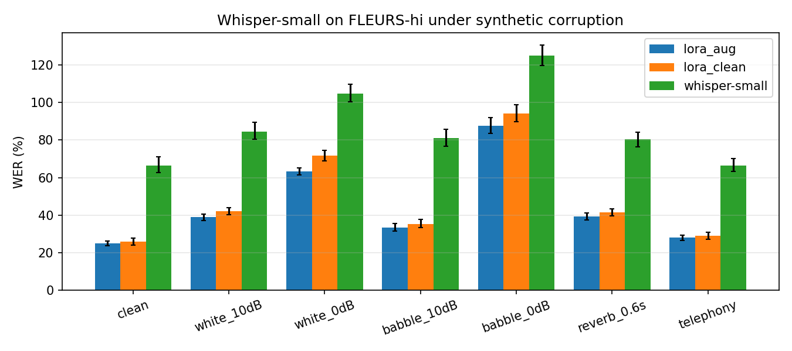

# indic-asr-eval

Robustness benchmark and LoRA fine-tuning for Hindi ASR with Whisper, built to answer two questions:

1. **How much do scoring conventions distort Indic WER?** Whisper's default text normaliser silently rewrites Devanagari.
2. **Does noise-augmented fine-tuning buy robustness at no clean-speech cost?** Evaluated under 7 synthetic acoustic conditions with paired significance tests.

Everything runs on a single 16 GB Apple-silicon laptop (PyTorch MPS, fp32).



## Headline results — FLEURS `hi_in` test (418 utterances)

WER %, `indic` normaliser. Full tables with CIs, CER and diagnostics: [`results/REPORT.md`](results/REPORT.md).

| model | clean | white 10 dB | white 0 dB | babble 10 dB | babble 0 dB | reverb 0.6 s | telephony |
|---|---|---|---|---|---|---|---|
| whisper-small (zero-shot) | 66.6 | 84.6 | 104.7 | 81.1 | 125.1 | 80.4 | 66.4 |
| + LoRA, clean data | 25.8 | 42.2 | 71.6 | 35.4 | 94.1 | 41.6 | 29.0 |
| + LoRA, noise-augmented | **25.0** | **39.0** | **63.5** | **33.5** | **87.6** | **39.3** | **28.1** |

- **LoRA fine-tuning** (9.4M trainable params, 3.8% of the model, 2 epochs on 2.1k utterances) cuts clean WER **66.6 → 25.8** (CER 34.0 → 10.3).
- **Augmented vs clean fine-tuning** (paired bootstrap, 2000 resamples): significantly better under white 10 dB (−3.2, p<0.001), white 0 dB (**−8.2**, p<0.001), babble 10 dB (−1.9, p=0.014), babble 0 dB (**−6.5**, p=0.002) and reverb (−2.3, p<0.001). On clean speech and telephony it is no worse (−0.9, p=0.056), so robustness comes free.
- **Smaller checkpoints fail on script, not acoustics.** Zero-shot whisper-tiny and whisper-base emit Latin-script output for 95.5% and 79.2% of Hindi utterances (WER 140 and 127). The *off-script* diagnostic catches this; WER alone does not explain it.
- **Hallucination under noise.** Zero-shot whisper-small produces outputs >1.5× the reference length on 4.8% of *clean* utterances, and WER exceeds 100% at 0 dB SNR. Fine-tuning removes this on clean speech (0.0–0.5%).

## Finding: Whisper's normaliser understates Indic WER by ~18 points

`transformers`' `BasicTextNormalizer`, used by most Whisper evaluation scripts, replaces every Unicode *mark* character with a space. In Devanagari, marks are the vowel signs (matras), virama and nukta. So:

```
किताब  ->  क त ब        # one word becomes three consonant fragments
कीताब  ->  क त ब        # a wrong vowel sign is now "correct"
```

Same hypotheses, scored four ways (clean test set):

| model | raw | whisper_basic | **indic** | indic_lenient |
|---|---|---|---|---|
| whisper-small | 71.4 | 48.8 | **66.6** | 65.6 |
| + LoRA, clean | 30.8 | 17.0 | **25.8** | 24.9 |
| + LoRA, augmented | 29.9 | 16.9 | **25.0** | 24.0 |

`whisper_basic` reports **48.8%** where the script-aware normaliser gives **66.6%**. Vowel-sign errors become invisible, and fragmenting inflates the word count that the denominator uses. Indic WERs computed this way are not comparable to properly normalised ones.

`indic` ([`asr_eval/normalize.py`](asr_eval/normalize.py)) applies NFC, unifies precomposed and decomposed nukta, strips zero-width joiners, maps Devanagari digits to ASCII and removes punctuation including danda. It keeps all marks. `indic_lenient` additionally folds nukta and chandrabindu, which are common annotator-inconsistency points.

## What's in the repo

| path | |
|---|---|
| `asr_eval/perturb.py` | Corruptions: white and babble noise at **exact SNR**; synthetic RIR reverb (exponential decay to −60 dB at RT60); telephony (8 kHz, 300–3400 Hz band-pass, μ-law); speed. All are seeded per utterance, so every model sees identical corrupted audio. Babble is mixed from 4 *validation* speakers, disjoint from test. |
| `asr_eval/metrics.py` | Corpus WER/CER with utterance-level bootstrap CIs; paired bootstrap test. |
| `asr_eval/normalize.py` | `raw`, `whisper_basic`, `indic`, `indic_lenient`. |
| `transcribe.py` | Batched greedy decoding, length-sorted to minimise padding. On OOM it splits the batch and retries. Caches hypotheses to `results/hyps/<model>/<cond>.jsonl`. |
| `finetune.py` | LoRA (r=32, α=64) on all decoder layers plus the top-4 encoder layers (q/k/v/out/fc1/fc2), gradient checkpointing. `--augment` applies a random corruption to 80% of training clips (babble drawn from *train* speakers). |
| `score.py` | Tables, diagnostics (off-script / hallucination / truncation rates), paired tests and the plot. |
| `adapters/` | The two trained LoRA adapters (36 MB each) and their training logs. |
| `tests/` | SNR exactness, determinism, normaliser behaviour and metric sanity checks. |

## Reproduce

```bash
pip install -r requirements.txt
python download.py                 # FLEURS hi_in parquet -> data/
pytest -q tests
./run_all.sh                       # zero-shot -> 2x LoRA -> robustness eval -> score.py
```

Evaluate a released adapter without training:

```bash
python transcribe.py --model openai/whisper-small --adapter adapters/lora_aug --tag lora_aug
python score.py
```

On a 16 GB M-series Mac, each fine-tune takes 2.5–3 h and each 418-utterance eval pass 10–15 min. `run_all.sh` sets `PYTORCH_MPS_HIGH_WATERMARK_RATIO` so the run stays usable alongside other apps. fp16 on MPS overflows to NaN in Whisper's decoder (output `!!!!`), so everything runs in fp32. Use `--fp16` on CUDA.

## Notes and limitations

- **Effective batch size.** Both runs use 16 utterances per step. The augmented run used `bs 1 × accum 16` instead of `2 × 8` to fit in memory; all other hyperparameters and the seed are identical.
- **Synthetic corruptions.** Babble, RIR and telephony are simulated, not recorded. They rank models usefully, but absolute numbers will differ from real far-field or call-centre audio.
- **Scope.** One language, one dataset, one seed per configuration. The clean-vs-augmented gaps are significant under paired resampling of test utterances, but that test does not capture seed variance.
- **Decoding.** Greedy decoding, no LM. Beam search (`--beams`) is supported but was not used for the reported numbers.
